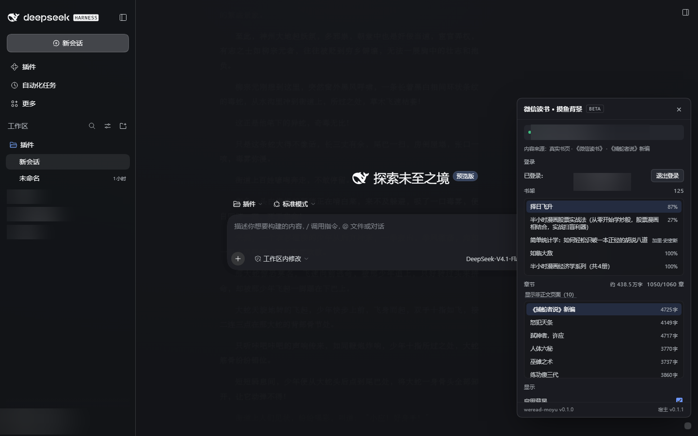
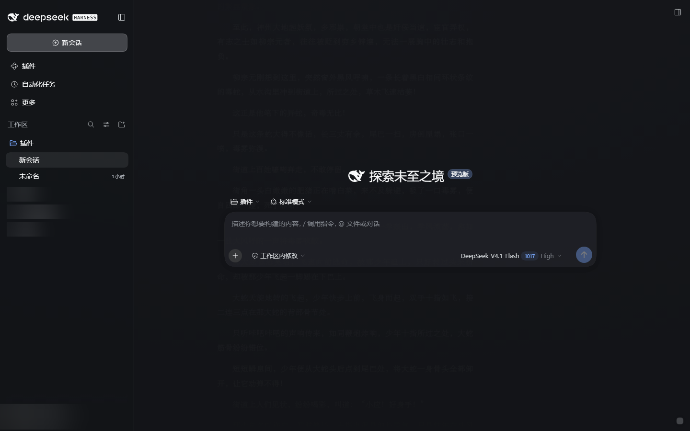
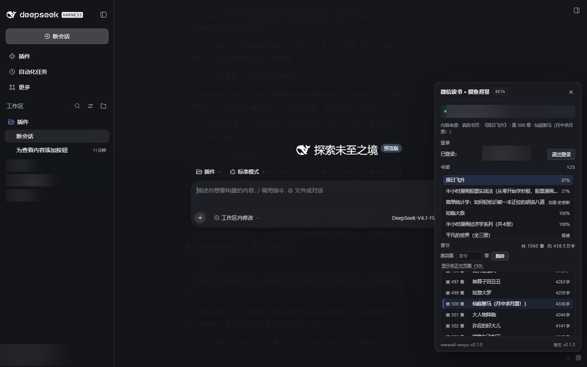
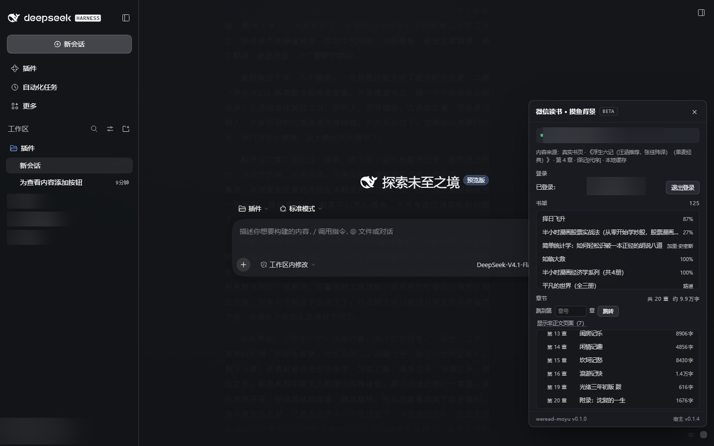
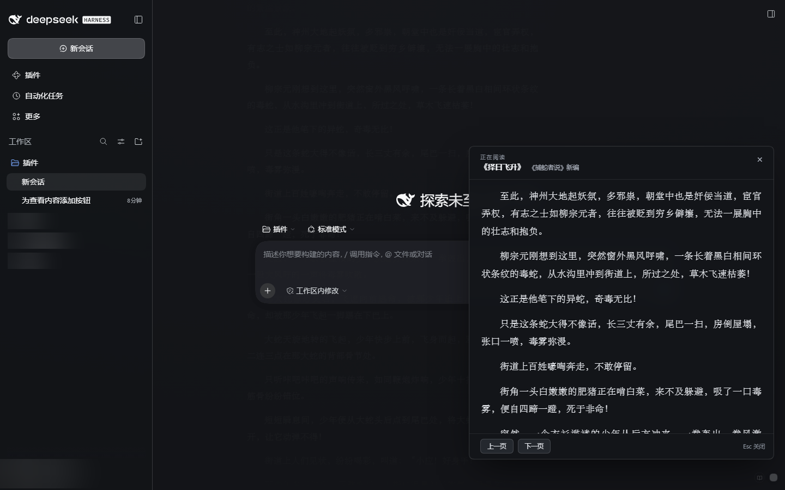

# 微信读书 · 摸鱼背景（DeepSeek Harness 插件）

`dsh-weread-moyu` —— 一个 DSH（DeepSeek Harness）Web GUI 插件：**扫码登录微信读书，把当前书页正文以低对比度文字层垫在整个界面背后**，聊天/工作区半透明浮在上面，看起来像一个"文档/代码工作区"。右下角只有两个极不显眼的小按钮：小书按钮看清当前页，小圆点打开控制面板。

> 用于上班摸鱼：屏幕上是正常的 DSH 工作界面，背后是《平凡的世界》或《三体》，字看得清但不抢注意力。

## 效果

真实 DSH GUI（已登录，控制面板打开，背后是微信读书真实书页）：



只开背景（无面板）时：



## 功能

- **登录**：扫码登录（优先）或粘贴浏览器 Cookie；登录态持久化在 `~/.dsh/weread-moyu/session.json`（文件权限 600，不会进日志）。
- **背景层**：`position:fixed; inset:0; z-index:0; pointer-events:none` 的阅读文字层，居中一列 62ch，行高 1.9，默认透明度 18%，可调 4%–35%。
- **外壳半透明**：覆盖 DSH 的 `--dsw-alias-bg-base/layer-*` 主题变量为半透明玻璃，`html/body/#root` 透明化，并把背景层压到 AppFrame 之下。
- **自动滚动**：4 档速度（暂停 / 慢 / 正常 / 快），每 30–60ms 上移 1px；读到章末自动续下一章，必要时自动换书。
- **控制面板**：扫码/ Cookie 登录、退出登录、书架（125 本以内分页）、**章节目录（完整显示「第 N 章」+ 共 N 章 + 跳到第 N 章）**、透明度/字号/速度滑块、启用背景、点击穿透、内容来源提示（真实书页 / 内置演示文本）。
- **整本缓存 / 离线阅读**：选中书后点「缓存整本」，宿主把整本章节正文下载到 `~/.dsh/weread-moyu/cache/<bookId>/`（带进度、可取消、可清除、可断点续传）。缓存后 `/content` 直接读本地、不再请求微信读书——**未登录也能读已缓存的书**（书架显示「离线缓存」分组，打开自动续读上次位置），重启应用后依然有效。单本上限 2000 万字、缓存目录上限 500MB。
- **看清当前页（peek）**：右下角小圆点旁边有一个更淡的小书按钮，点一下弹出**连续滚动阅读浮层**——完整镜像当前内容，**读到本章最后继续往下滑会无缝续接下一章**（滚轮/触摸在底部也持续补载），底部 `上一章` / `下一章` 按钮直接跳章（自动跳过封面/版权页），关闭时背景层自动同步到你读到的位置；头部 `A-` / `A+` 直接调字号（与设置面板滑块联动），左下角拖拽手柄可自由调整浮层大小（双击恢复默认），Esc 关闭。
- **抗风险**：宿主半没就绪 → 自动进演示文本模式（《古文观止》选段），视觉先可用；网络失败指数退避静默重试，不刷错；非正文页（封面/版权页，返回 XML）自动跳过。
- **零依赖**：客户端 bundle 手写、不 require 任何包；宿主半只用 `node:` 内建模块。







## 安装

插件已经装进本机 Desktop profile（`~/.dsh/profiles/desktop`），安装命令（重装/更新时用）：

```powershell
dsh plugin --profile desktop add "file:D:\Alan\插件"
```

安装会：把包放进 profile 的 `node_modules`、写入 `dsh.profile.bundles`、由 profile 的 bundle patch 插入插件行。

**⚠️ 需要重启 DeepSeek Harness 一次**：客户端 bundle 由启动时的 boot graph 下发，运行中的页面不会自动加载新插件。重启后打开任意会话即可看到背景层；右下角小圆点打开面板。

## 使用

1. 重启后，右下角有 2 个很淡的小圆点：左边的小书按钮 = **看清当前页**（peek），右边的小圆点 = 设置面板。
2. **扫码登录**：点「扫码登录」，用手机微信扫码并确认；或点「Cookie 登录」粘贴浏览器里 `weread.qq.com` 的 Cookie（至少含 `wr_vid`、`wr_skey`、`wr_rt`）。
3. 选择一本书（书架列表）→ 选章节；目录里每条都带「第 N 章」，上方有「共 N 章」，想找具体章节直接在「跳到第 [ ] 章」输入章号回车/点跳转。
4. 调「透明度」（建议 12%–22%）、「字号」、「速度」，然后关掉面板。
5. **想离线读**：选中书 → 章节区下面的 `缓存整本（约 X 字）`，等进度跑完（可取消，已下载的章节会保留，下次点「继续缓存」接着下）；缓存完成后内容来源会标「本地缓存」，不再请求微信读书。`清除缓存` 可随时删掉。
6. 想认真读一段时，点小书按钮：浮层是**连续滚动的阅读器**（滚动到底自动加载下一页/下一章，不会重复段落），头部 `A-` / `A+` 调字号，左下角拖拽手柄缩放窗口（双击恢复默认），Esc 关闭后背景层自动同步到你读到的位置。
7. 关闭面板后两个小按钮仍在；不需要时把「启用背景」关掉即可。

## 带到其他电脑 / 上架插件市场

- **DSH 账号不会自动同步插件**：插件是按机器、按 profile 安装的本地文件；登录同一账号只共享账号/计费。
- 三种做法（详见 [docs/DISTRIBUTION.md](docs/DISTRIBUTION.md)）：

  | 方式 | 做法 | 适合 |
  |---|---|---|
  | 拷贝目录 / tarball | 另一台电脑上运行 `install.ps1`，或 `dsh plugin --profile desktop add <tgz路径>` | 自己的几台电脑，离线可用 |
  | 发布 npm 包 | 仓库根 `npm publish --access public`，另一台 `dsh plugin --profile desktop add dsh-weread-moyu` | 团队/公开分享，支持一条命令安装和更新 |
  | 上架插件市场 | 公开 GitHub 仓库 + Release tarball（或 npm 包）→ 到 `awesome-dsh-plugin/awesome-dsh-plugin` 提 PR | 让市场里所有人能搜到、一键安装 |

- 每次安装/更新后都要**完全退出并重新打开 DSH**（客户端 bundle 只在启动时加载）。
- 微信读书登录态不随插件同步：新机器上扫码登录一次即可；不建议明文拷贝 `session.json`。
- 市场自带「备份与恢复 / WebDAV / Gist 同步」只同步插件清单与配置，不传代码，所以本地 `file:` 安装的插件要先换成 npm/GitHub 来源才能跨机恢复。

## 目录结构

```
.
├─ package.json               # 插件包声明（dsh.bundle.patch + dsh.client，仓库根即安装单位）
├─ cordis.patch.yml           # 向 profile 插入 weread-moyu 行
├─ lib/
│  ├─ index.js                # 宿主半：/weread-moyu/api/* 路由、登录态、书架/章节/正文
│  ├─ weread.js               # 微信读书协议实现（二维码登录、正文解密、分页）
│  └─ cache.js                # 整本缓存存储（断点续传 / 进度）
├─ client/
│  └─ client.js               # 客户端 bundle（背景层 + 控制面板，手写无构建）
├─ tests/                      # 无 GUI 验证脚本
│  ├─ host-smoke.mjs           # 宿主 API 单测（8 项）
│  ├─ boot-graph-check.mjs     # 真实 Host 的 boot graph / bundle / API 检查
│  └─ browser-verify.mjs       # 无头 Edge 打开真实 GUI、DOM 断言 + 截图
├─ scripts/
│  ├─ weread-login.mjs         # 一次性扫码登录（生成二维码 PNG、落 cookie）
│  └─ weread-probe.mjs         # 协议探针：selftest/qr/shelf/chapters/content/walk/all
├─ examples/                   # 验收截图、客户端 harness、二维码
├─ dist/                       # 分发包（npm pack 产出，不入库）
├─ pack.ps1                    # 一键重新打包 dist/dsh-weread-moyu-<version>.tgz
└─ docs/
   ├─ spec.md                  # 构建契约（接口、边界、验收）
   ├─ client-plugin-contract.md# 客户端插件实测契约
   ├─ weread-protocol.md       # 微信读书协议笔记（端点/加密/坑/降级）
   └─ DISTRIBUTION.md          # 跨电脑分发 / npm 发布 / 市场上架指南
```

## 宿主 API（给二次开发）

| 方法 | 路径 | 说明 |
|---|---|---|
| GET | `/weread-moyu/api/ping` | 健康检查 `{ok, version, wereadReady}` |
| GET | `/weread-moyu/api/status[?refresh=1]` | 登录态 + 书架 `{loggedIn, user, books, sessionExpired}` |
| GET | `/weread-moyu/api/qr` | 创建登录二维码 `{ok, uid, qrDataUrl, expiresAt}` |
| GET | `/weread-moyu/api/qr/poll?uid=` | `{state: waiting\|scanned\|confirmed\|expired\|error}` |
| POST | `/weread-moyu/api/login/cookie` | body `{cookie}`，校验并保存 |
| POST | `/weread-moyu/api/logout` | 清除登录态 |
| GET | `/weread-moyu/api/books/:bookId/chapters` | 章节列表 `{chapters:[{chapterUid,title,level,wordCount}]}` |
| GET | `/weread-moyu/api/content?bookId=&chapterUid=&pos=&maxChars=` | 正文分页 `{chapterTitle,lines,pos,hasMore,nextChapterUid,progress,preview}` |

路由只接受 loopback（127.0.0.1 / ::1）请求；全部 `cache-control: no-store`。

## 开发与验证

Node 用 DSH 自带的 Electron-as-Node 24（系统 node 是 v16，太旧）：

```powershell
$exe = "D:\Program Files\deepseekHarmess\DeepSeek Harness.exe"
# 宿主半单测
& $exe "D:\Alan\插件\tests\host-smoke.mjs"
# 起一个独立测试 Host（端口 3099），跑 boot graph + bundle + API 检查
& $exe "D:\Alan\插件\tests\boot-graph-check.mjs" "http://127.0.0.1:3099/?token=<token>"
# 无头 Edge 打开真实 GUI、断言背景层/面板、截图
& $exe "D:\Alan\插件\tests\browser-verify.mjs" "http://127.0.0.1:3099/?token=<token>" "D:\Alan\插件\examples\live.png"
# 微信读书协议自检/探针
& $exe "D:\Alan\插件\scripts\weread-probe.mjs" selftest
& $exe "D:\Alan\插件\scripts\weread-probe.mjs" content --book 695233 --chapter 94 --max 500
```

客户端 bundle 是手写的（无构建步骤），格式见 `docs/client-plugin-contract.md`。

## 卸载

```powershell
dsh plugin --profile desktop remove dsh-weread-moyu
```

再从 `~/.dsh/profiles/desktop/package.json` 的 `dsh.profile.bundles` 中删掉 `dsh-weread-moyu`（如仍在），重启应用即可。登录态可删 `~/.dsh/weread-moyu/`。

## 已知限制 / 说明

- 微信读书未购/未解锁章节只能读到试读片段（`preview:true`，以 `...` 结尾），这是上游限制；公版书/网文/试读章节可整本读。匿名也能读 `maxFreeChapter` 范围内的免费章节。
- 正文来自微信读书 Web 端接口，若上游改协议，`docs/weread-protocol.md` 记录了签名/解密细节，便于修复。
- 登录 Cookie 存本机明文文件（仅当前用户可读），不会发给除 `weread.qq.com` 之外的任何服务。
- 本插件只读取你账号本来就能读的内容，不绕过付费/版权限制；请仅用于个人已购内容的阅读。
